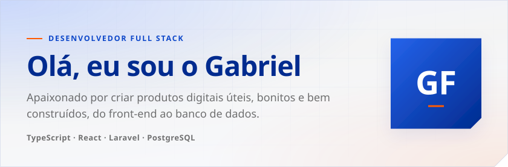
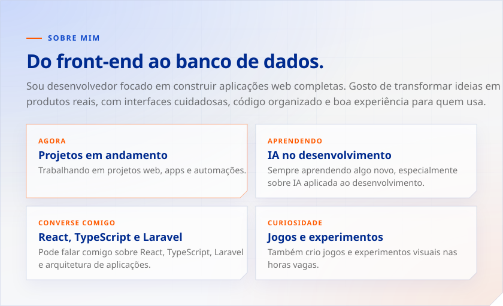
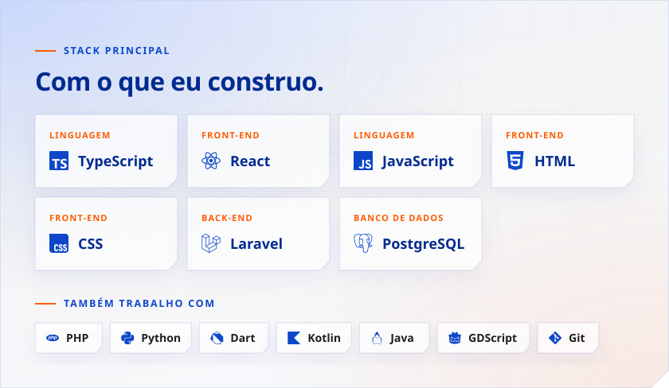

<picture>
  <source media="(prefers-color-scheme: dark)" srcset="./assets/header-dark.svg" />
  
</picture>

  
  &nbsp;
  

<picture>
  <source media="(prefers-color-scheme: dark)" srcset="./assets/sobre-dark.svg" />
  
</picture>

<picture>
  <source media="(prefers-color-scheme: dark)" srcset="./assets/stack-dark.svg" />
  
</picture>

<picture>
  <source media="(prefers-color-scheme: dark)" srcset="./assets/stats-dark.svg" />
  
</picture>

  <picture>
    <source media="(prefers-color-scheme: dark)" srcset="https://github-readme-stats.vercel.app/api?username=DashiGabriell&show_icons=true&locale=pt-br&border_radius=0&title_color=E8EEFF&text_color=A1A2A6&icon_color=FF7A1A&bg_color=1A1D26&border_color=2A3550" />
    
  </picture>
  <picture>
    <source media="(prefers-color-scheme: dark)" srcset="https://github-readme-stats.vercel.app/api/top-langs/?username=DashiGabriell&layout=compact&locale=pt-br&border_radius=0&title_color=E8EEFF&text_color=A1A2A6&bg_color=1A1D26&border_color=2A3550" />
    
  </picture>

  <picture>
    <source media="(prefers-color-scheme: dark)" srcset="https://streak-stats.demolab.com?user=DashiGabriell&locale=pt_BR&border_radius=0&background=1A1D26&border=2A3550&stroke=2A3550&ring=FF7A1A&fire=FF7A1A&currStreakNum=E8EEFF&sideNums=E8EEFF&currStreakLabel=FF7A1A&sideLabels=A1A2A6&dates=A1A2A6" />
    
  </picture>

<picture>
  <source media="(prefers-color-scheme: dark)" srcset="./assets/footer-dark.svg" />
  
</picture>
